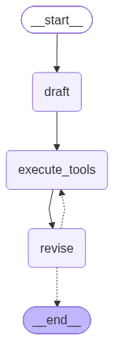

# 🦜🔁 LangGraph Reflexion Agent

A Reflexion agent built with [LangGraph](https://langchain-ai.github.io/langgraph/) that answers research questions, critiques its own answer, searches the web for missing facts, and revises the answer with citations.

## ✨ Overview

The agent follows the [Reflexion](https://arxiv.org/abs/2303.11366) pattern. Unlike a plain reflection loop, each critique comes with concrete search queries, and the agent grounds its revisions in real search results:

- **draft** writes a ~250 word answer, a self-critique (what is missing and what is superfluous), and 1-3 search queries.
- **execute_tools** runs those queries with Tavily Search.
- **revise** rewrites the answer using the search results and the critique, adds numbered citations and a references list, and proposes new queries.

The graph is compiled in `main.py`. The prompts and chains are in `chains.py`, the Pydantic output schemas are in `schemas.py`, and the search tool node is in `tool_executor.py`.

<p align="center"></p>

## 🔄 How It Works

1. **Draft**: `draft_node` calls `first_responder`, which is forced to call the `AnswerQuestion` tool. The model returns its answer, its reflection, and its search queries as structured tool-call arguments.
2. **Search**: `execute_tools` is a LangGraph `ToolNode`. It maps the `AnswerQuestion` and `ReviseAnswer` tool calls to `run_queries`, which runs every query through Tavily in one batch and returns the results as a `ToolMessage`.
3. **Revise**: `revise_node` calls `revisor`, which is forced to call the `ReviseAnswer` tool. It adds a `references` field to the answer.
4. **Loop**: `event_loop` counts the `ToolMessage`s in state. While the count is at most `MAX_ITERATIONS` (2), the graph goes back to `execute_tools` with the new queries. After that it ends.

With `MAX_ITERATIONS = 2`, a full run makes 1 draft, 3 search rounds, and 3 revisions.

## 💻 Installation

Requirements: Python 3.11+ and [uv](https://docs.astral.sh/uv/).

```bash
git clone https://github.com/HaykSahakyan11/Langgraph_tutorial.git
cd Langgraph_tutorial
git checkout project/reflexion-agent

# Create the virtual environment and install dependencies from pyproject.toml / uv.lock
uv sync
```

### Configuration

Copy the example env file and fill in your keys:

```bash
cp .env.example .env
```

```env
OPENAI_API_KEY=your-openai-api-key   # used by ChatOpenAI (gpt-5.4-mini)
TAVILY_API_KEY=your-tavily-api-key   # used by TavilySearch

# Optional: LangSmith tracing
# LANGSMITH_TRACING=true
# LANGSMITH_API_KEY=your-langsmith-api-key
# LANGSMITH_PROJECT=reflexion-agent
```

`chains.py` and `tool_executor.py` call `load_dotenv()`, so the variables load automatically. Never commit `.env`. It is listed in `.gitignore`.

API keys: [OpenAI Platform](https://platform.openai.com/), [Tavily](https://tavily.com/), and [LangSmith](https://smith.langchain.com/) (optional).

## ▶️ Running

Run the full graph:

```bash
uv run main.py
```

This prints the graph as Mermaid, renders it to `flow.png`, runs the agent on the example question, and prints the final answer and its references. `draw_mermaid_png` calls the Mermaid.ink web service by default, so it needs internet access.

To test only the first responder chain, run:

```bash
uv run chains.py
```

### Example run

A test run with the question *"What is LangGraph and how is it different from LangChain?"* went through the nodes in this order:

```
[1] draft          → answer + critique + 3 search queries
[2] execute_tools  → Tavily results
[3] revise         → revised answer, 3 references, new queries
[4] execute_tools
[5] revise
[6] execute_tools
[7] revise         → END (3 tool results > MAX_ITERATIONS)
```

Final answer (excerpt):

> LangGraph is a low-level orchestration framework for building stateful, long-running LLM workflows as graphs with nodes, edges, shared state, branching, loops, checkpoints, and human-in-the-loop pauses [1]. LangChain is the broader LLM app framework that provides models, prompts, tools, retrievers, and agent abstractions [2].
>
> The simplest distinction is: LangChain gives you the building blocks; LangGraph gives you the execution model for how those blocks interact over time. [...]
>
> [1] https://docs.langchain.com/oss/python/langgraph/overview<br>
> [2] https://docs.langchain.com/oss/python/langchain/overview

## 📁 Project Structure

```
Langgraph_tutorial/
├── chains.py         # Actor prompt, first responder and revisor chains
├── schemas.py        # Pydantic models: Reflection, AnswerQuestion, ReviseAnswer
├── tool_executor.py  # Tavily search wrapped in a ToolNode
├── main.py           # LangGraph nodes, edges, loop condition, and entry point
├── flow.png          # Graph diagram generated by main.py (shown in this README)
├── .env.example      # Template for the required environment variables
├── LICENSE.txt       # Apache License 2.0
├── pyproject.toml    # Project metadata and dependencies
├── uv.lock           # Locked dependency versions
└── README.md         # This documentation
```

## 🛠️ Implementation Details

### Schemas (`schemas.py`)

- `Reflection`: `missing` and `superfluous` critique fields.
- `AnswerQuestion`: `answer`, `reflection`, and `search_queries`.
- `ReviseAnswer`: extends `AnswerQuestion` with `references`.

The models are passed to `bind_tools`, so the LLM returns structured output as tool calls.

### Chains (`chains.py`)

- `actor_prompt_template`: a shared "expert researcher" system prompt with the current time and a `{first_instruction}` slot.
- `first_responder`: the template with "Provide a detailed ~250 word answer", bound to `AnswerQuestion` with `tool_choice` forced.
- `revisor`: the template with revision instructions (use the critique, add numbered citations, stay under 250 words), bound to `ReviseAnswer`.

### Tools (`tool_executor.py`)

- `TavilySearch(max_results=5)`.
- `run_queries` batches all search queries into one call.
- The `ToolNode` registers `run_queries` twice, under the names `AnswerQuestion` and `ReviseAnswer`, so both kinds of tool call trigger a search.

### Graph (`main.py`)

- **State**: `MessagesState`.
- **Nodes**: `draft`, `execute_tools`, and `revise`.
- **Edges**: `START → draft → execute_tools → revise`, then a conditional edge from `revise` to `execute_tools` or `END` through `event_loop`.

## 📦 Dependencies

Declared in `pyproject.toml`:

- `langgraph`, `langchain`, `langchain-openai`: graph orchestration and the OpenAI chat model
- `langchain-tavily`: Tavily web search tool
- `python-dotenv`: loads environment variables from `.env`
- `grandalf`: renders ASCII graphs
- `black`, `isort`: code formatting

## 👤 Author

**Hayk Sahakyan**. GitHub: [@HaykSahakyan11](https://github.com/HaykSahakyan11)

I built this project while working through a LangGraph course. Each agent is on its own `project/*` branch of this repository.

## 📚 Resources

- [LangGraph course on Udemy](https://www.udemy.com/course/langgraph/) by Eden Marco, which this project follows ([course repo](https://github.com/emarco177/langgraph-course))
- [LangGraph Reflexion tutorial](https://langchain-ai.github.io/langgraph/tutorials/reflexion/reflexion/)
- [Reflexion: Language Agents with Verbal Reinforcement Learning](https://arxiv.org/abs/2303.11366) (Shinn et al., 2023)
- [LangChain](https://github.com/langchain-ai/langchain) and [Tavily](https://tavily.com/)

## 📄 License

Apache License 2.0. See [LICENSE.txt](LICENSE.txt).
