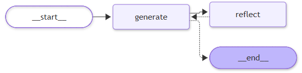

# 🦜🪞 LangGraph Reflection Agent

A reflection-style agent built with [LangGraph](https://langchain-ai.github.io/langgraph/) that improves its output through self-critique and refinement. This project implements a Twitter assistant that rewrites a tweet, critiques it, and revises it over several rounds.

## ✨ Overview

The agent runs a feedback loop between two LLM-backed nodes:

- **generate** writes (or revises) a tweet.
- **reflect** critiques the latest tweet and gives recommendations on length, virality, style, etc.

The graph is compiled in `main.py`, and the prompts and chains live in `chains.py`.



## 🔄 How It Works

1. **Generate**: `generation_node` takes the conversation so far and produces a tweet (or a revised version if critique is present).
2. **Check**: `should_continue` routes the graph. If the conversation holds more than 6 messages, it ends. Otherwise it goes to `reflect`.
3. **Reflect**: `reflection_node` critiques the tweet. The critique is added to the state as a `HumanMessage`, so the generator treats it as user feedback.
4. **Loop**: `reflect` always returns to `generate`, which refines the tweet using the critique.

Because termination depends on the number of messages in state (the original request plus each generation and each critique), a full run makes 4 generations and 3 reflections (8 messages) before it stops.

## 💻 Installation

Requirements: Python 3.11+ and [uv](https://docs.astral.sh/uv/).

```bash
git clone https://github.com/HaykSahakyan11/Langgraph_tutorial.git
cd Langgraph_tutorial
git checkout project/reflection-agent

# Create the virtual environment and install dependencies from pyproject.toml / uv.lock
uv sync
```

### Configuration

Create a `.env` file in the project root. `chains.py` uses `ChatOpenAI`, so an OpenAI key is required:

```env
OPENAI_API_KEY=your-openai-api-key
```

`main.py` calls `load_dotenv()`, so the variables are loaded automatically. Never commit `.env`. It is listed in `.gitignore`.

## ▶️ Running

```bash
uv run main.py
```

This prints the graph as Mermaid and ASCII, renders it to `flow.png`, runs the agent on the example tweet, and prints the final revised tweet. Rendering the PNG with `draw_mermaid_png` calls the Mermaid.ink web service by default, so it needs internet access.

## 📁 Project Structure

```
Langgraph_tutorial/
├── chains.py         # Prompts and LLM chains for generation and reflection
├── main.py           # LangGraph state, nodes, conditional edge, and entry point
├── flow.png          # Rendered diagram of the graph (generated by main.py)
├── ref_agent.png     # Graph image shown at the top of this README
├── pyproject.toml    # Project metadata and dependencies
├── uv.lock           # Locked dependency versions
└── README.md         # This documentation
```

## 🛠️ Implementation Details

### Chains (`chains.py`)

- `generation_prompt`: system prompt for a "twitter techie influencer assistant" that writes the best post possible and revises it when critique is provided.
- `reflection_prompt`: system prompt for a "viral twitter influencer" that grades the tweet and gives detailed recommendations.
- `generate_chain` and `reflect_chain`: each is `prompt | ChatOpenAI()`.

### Graph (`main.py`)

- **State**: `MessageGraph`, a `TypedDict` with a `messages` list that uses the `add_messages` reducer.
- **Nodes**: `generate` (`generation_node`) and `reflect` (`reflection_node`).
- **Entry point**: `generate`.
- **Edges**: a conditional edge from `generate` to `reflect` or `END` via `should_continue`, and a fixed edge from `reflect` back to `generate`.

## 🔍 Example Usage

```python
from langchain_core.messages import HumanMessage
from main import graph

inputs = {
    "messages": [
        HumanMessage(
            content="""Make this tweet better:
@LangChainAI — newly Tool Calling feature is seriously underrated.
After a long wait, it's here- making the implementation of agents across different models with function calling - super easy.
Made a video covering their newest blog post"""
        )
    ]
}

response = graph.invoke(inputs)

# The last message is the final revised tweet
print(response["messages"][-1].content)
```

## 📦 Dependencies

Declared in `pyproject.toml`:

- `langgraph`, `langchain`, `langchain-openai`: graph orchestration and the OpenAI chat model
- `python-dotenv`: loads environment variables from `.env`
- `grandalf`: renders the ASCII graph (`print_ascii`)
- `langchain-tavily`: installed but not used yet
- `black`, `isort`: code formatting (also in the `dev` group)

## 👤 Author

**Hayk Sahakyan**. GitHub: [@HaykSahakyan11](https://github.com/HaykSahakyan11)

I built this project while working through a LangGraph course. Each agent is on its own `project/*` branch of this repository.

## 📚 Resources

- [LangGraph course on Udemy](https://www.udemy.com/course/langgraph/) by Eden Marco, which this project follows ([course repo](https://github.com/emarco177/langgraph-course))
- [LangGraph Reflection tutorial](https://langchain-ai.github.io/langgraph/tutorials/reflection/reflection/)
- [LangChain](https://github.com/langchain-ai/langchain)
