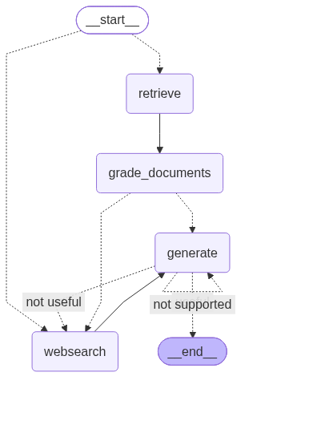

# 🦜🔍 LangGraph Agentic RAG

An adaptive RAG agent built with [LangGraph](https://langchain-ai.github.io/langgraph/). It combines three RAG patterns:

- **Adaptive RAG**: a router sends each question to the local vector store or to web search.
- **Corrective RAG**: retrieved documents are graded for relevance, and web search fills the gaps.
- **Self-RAG**: each answer is checked for hallucinations and for whether it answers the question, and is regenerated or supplemented if not.



## 🔄 How It Works

1. **Route** (`route_question`): the router chain picks `vectorstore` for questions about agents, prompt engineering, or adversarial attacks on LLMs, and `websearch` for everything else.
2. **Retrieve** (`retrieve`): fetches chunks from the Chroma vector store.
3. **Grade documents** (`grade_documents`): keeps only relevant chunks. If any chunk is irrelevant, it sets `web_search=True`.
4. **Web search** (`web_search`): runs a Tavily search and adds the results to the documents.
5. **Generate** (`generate`): answers the question from the documents in at most three sentences.
6. **Check the answer** (`grade_generation_grounded_in_documents_and_question`):
   - not grounded in the documents → `not supported` → generate again
   - grounded but does not answer the question → `not useful` → web search
   - grounded and answers the question → `useful` → END

The vector store contains three posts by Lilian Weng: [LLM Powered Autonomous Agents](https://lilianweng.github.io/posts/2023-06-23-agent/), [Prompt Engineering](https://lilianweng.github.io/posts/2023-03-15-prompt-engineering/), and [Adversarial Attacks on LLMs](https://lilianweng.github.io/posts/2023-10-25-adv-attack-llm/).

## 💻 Installation

Requirements: Python 3.11+ and [uv](https://docs.astral.sh/uv/).

```bash
git clone https://github.com/HaykSahakyan11/Langgraph_tutorial.git
cd Langgraph_tutorial
git checkout project/agentic-rag

uv sync
cp .env.example .env   # then fill in your keys
```

```env
OPENAI_API_KEY=your-openai-api-key   # chat model (gpt-5.4-mini) and embeddings
TAVILY_API_KEY=your-tavily-api-key   # web search
USER_AGENT=langgraph-tutorial        # identifies requests made by WebBaseLoader
```

## ▶️ Running

Build the vector store once. It downloads the three blog posts, splits them into 250-token chunks, and saves them to `.chroma/`:

```bash
uv run ingestion.py
```

Run the agent:

```bash
uv run main.py
```

`main.py` renders the graph to `graph.png` and asks *"agent memory?"*. A test run took the vector store route:

```
---ROUTE QUESTION TO RAG---
---RETRIEVE---
---GRADE: DOCUMENT RELEVANT--- (x4)
---DECISION: GENERATE---
---DECISION: GENERATION IS GROUNDED IN DOCUMENTS---
---DECISION: GENERATION ADDRESSES QUESTION---
Agent memory refers to how an LLM-powered agent stores and retrieves information over time. [...]
```

A general question such as *"Who won the 2022 FIFA World Cup?"* goes straight to web search, and the agent answered from Tavily results.

## 🧪 Tests

```bash
uv run pytest -q
```

`graph/chains/tests/test_chains.py` tests the router, the retrieval grader, the generation chain, and the hallucination grader against the real models (7 tests). They need API keys and a built vector store.

## 📁 Project Structure

```
Langgraph_tutorial/
├── main.py                    # Entry point: renders graph.png and runs the agent
├── ingestion.py               # Builds the Chroma vector store; exposes the retriever
├── graph/
│   ├── graph.py               # StateGraph: nodes, router entry point, conditional edges
│   ├── state.py               # GraphState: question, generation, web_search, documents
│   ├── consts.py              # Node names
│   ├── chains/
│   │   ├── router.py          # vectorstore vs websearch
│   │   ├── retrieval_grader.py
│   │   ├── generation.py
│   │   ├── hallucination_grader.py
│   │   ├── answer_grader.py
│   │   └── tests/test_chains.py
│   └── nodes/                 # retrieve, grade_documents, web_search, generate
├── graph.png                  # Graph diagram generated by main.py
├── static/                    # Extra images
├── .env.example
├── LICENSE.txt                # Apache License 2.0
├── pyproject.toml
└── uv.lock
```

## 👤 Author

**Hayk Sahakyan**. GitHub: [@HaykSahakyan11](https://github.com/HaykSahakyan11)

I built this project while working through a LangGraph course. Each agent is on its own `project/*` branch of this repository.

## 📚 Resources

- [LangGraph course on Udemy](https://www.udemy.com/course/langgraph/) by Eden Marco, which this project follows ([course repo](https://github.com/emarco177/langgraph-course))
- [Advanced RAG control flow with Mistral and LangChain](https://github.com/mistralai/cookbook/tree/main/third_party/langchain) by Sophia Yang (Mistral) and Lance Martin (LangChain), the original notebooks
- [LangGraph Adaptive RAG tutorial](https://langchain-ai.github.io/langgraph/tutorials/rag/langgraph_adaptive_rag/)
- Papers: [Adaptive-RAG](https://arxiv.org/abs/2403.14403), [Corrective RAG](https://arxiv.org/abs/2401.15884), [Self-RAG](https://arxiv.org/abs/2310.11511)

## 📄 License

Apache License 2.0. See [LICENSE.txt](LICENSE.txt).
